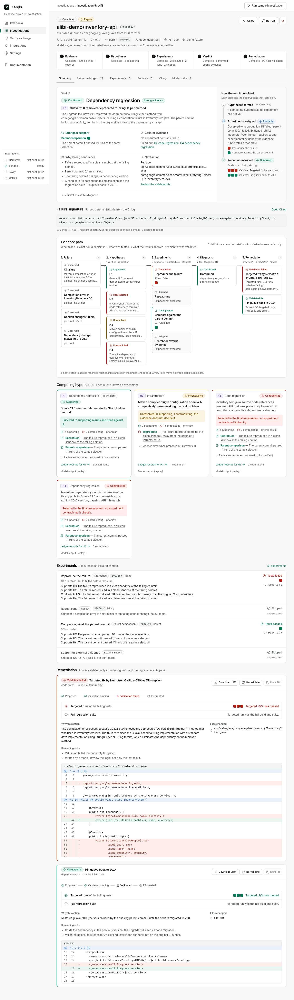

# Alibi

**Don't just explain the failure. Prove it.**

Alibi is a CI failure forensics tool. When a GitHub Actions build turns red, Alibi reads the log, forms competing hypotheses with NVIDIA Nemotron, and then **runs experiments in an isolated sandbox** to test them. It re-runs the failing test, repeats it to measure flakiness, compares against the parent commit, and validates a candidate fix against a regression test. Every conclusion is linked to an entry in an **Evidence Ledger** that records what was observed, what was executed, and what remains uncertain.

> A plausible explanation is not proof. Alibi only says *confirmed* when an experiment discriminates between explanations.



---

## Why Alibi exists

When CI fails, engineers inspect logs, re-run jobs, search issue trackers, compare commits, and argue about whether the latest change caused it. AI assistants shorten the log-reading step, but they summarize the error and stop there: the explanation sounds right, and nobody tests it. Teams then quarantine real regressions as "flaky", or revert innocent commits.

Alibi treats a failed build as an investigation. Each candidate explanation has to survive an experiment.

## Who it serves

- **Software engineers** who want to know whether their change broke the build before re-running it a fifth time.
- **Platform and DevOps teams** who triage flaky tests, dependency regressions, and infrastructure failures across many repositories.
- **Engineering managers** who want flaky-test decisions backed by measured failure rates rather than intuition.

## How it works

```
CI log + commit diff ──► 1. Evidence      deterministic parsing, secret redaction, long-log context selection
                         2. Hypotheses    Nemotron (Lightning) proposes 2–4 competing causes; cited log quotes are machine-checked
                         3. Experiments   deterministic planner → local Docker runs (reproduce / repeat / parent / search)
                         4. Verdict       Nemotron (Super) weighs the executed results once; a rubric caps "confirmed" unless evidence is strong
                         5. Remediation   quarantine / dependency pin / model-written fix → validated in a fresh sandbox
```

By default Alibi is a **single-pass** investigation, not an iterative agent loop: the model is consulted once to form hypotheses and once to weigh results. Experiments are not fed back to the model to choose a next experiment.

### Experimental: bounded agent loop (`ALIBI_LOOP=1`, off by default)

When `ALIBI_LOOP=1` (or `true`), a bounded loop runs after the deterministic experiments: Nemotron (Super) sees the actual results and proposes **one** next action per iteration, chosen from a fixed allowlist (`reproduce`, `run_test`, `repeat` on the failing or parent commit, or `search`). Nothing the model writes is executed: a deterministic policy maps approved proposals onto the existing command templates and rejects commands, paths, environment, unknown tests, and duplicates. A model-written fix that fails validation gets one retry with the real failure output (test files are not editable in the retry). The loop reports two independent outcomes — **diagnosis** (`CONFIRMED` / `PROBABLE` / `INCONCLUSIVE` / `BLOCKED`, about the cause) and **fix** (`VERIFIED` / `REJECTED` / `NONE`, `VERIFIED` only after fresh-sandbox validation) — so a confirmed cause is never presented as a validated fix.

Status: covered by offline tests (scripted model, real Docker sandbox). **Not yet verified against the live Token Factory API.**

| Variable | Default | Hard cap | Meaning |
|---|---|---|---|
| `ALIBI_LOOP` | off | — | `1` or `true` enables the loop. Any other value, or unset, keeps single-pass behaviour. |
| `ALIBI_LOOP_MAX_ITERATIONS` | 4 | 4 | Loop iterations (each makes one decision call; a rejected proposal still uses an iteration). |
| `ALIBI_LOOP_MAX_MODEL_CALLS` | 4 | 4 | Decision calls made by the loop. |
| `ALIBI_LOOP_MAX_TOKENS` | 40000 | — | Prompt + completion tokens across loop decision calls. |
| `ALIBI_LOOP_MAX_MS` | 480000 (8 min) | — | Wall-clock time for the loop. |
| `ALIBI_LOOP_MAX_RUNS` | 30 | — | Sandbox test runs the loop may start (the deterministic baseline does not count). |
| `ALIBI_LOOP_MAX_RUNS_PER_ACTION` | 10 | 20 | Maximum `runs` for one `repeat` action. |
| `ALIBI_LOOP_MAX_SEARCHES` | 2 | 3 | Tavily searches the loop may start (0 effective when `TAVILY_API_KEY` is unset). |

How the limits are enforced (see `server/src/pipeline/agentLoop.ts`):

- **Iterations, decision calls, runs, searches** are checked before each model call or execution; runs and searches are charged before they start, so these are hard limits.
- **Tokens and time are checked between steps, not during them.** An in-flight decision call or sandbox experiment is not interrupted, so the loop can exceed `ALIBI_LOOP_MAX_TOKENS` by one decision call and `ALIBI_LOOP_MAX_MS` by one model call (up to `NEBIUS_TIMEOUT_MS` × (1 + `NEBIUS_MAX_RETRIES`) plus backoff) or one experiment (up to `runs` × `ALIBI_RUNNER_TIMEOUT_SEC`). Tokens are counted from the provider's `usage` field; if a response omits it, that call counts as 0 tokens.
- Loop calls also draw from the per-investigation `ALIBI_MAX_MODEL_CALLS` budget (default 8: triage, up to 4 loop decisions, verdict, patch, patch retry). If that budget runs out, the loop stops with a model error.
- Model failures (timeout, HTTP error, invalid output) stop the loop with `model_error`; the investigation continues to the verdict with the evidence already gathered. A replay without a recorded loop step, or heuristic mode, stops the loop with `model_unavailable` before any call.
- Non-numeric values fall back to the default. There is no lower bound: `0` effectively disables that resource.

### 1. Evidence
The CI log (from the GitHub API, or a recorded fixture in demo mode) is **redacted** for tokens, keys, and credentials before it is stored, shown, or sent to any model. Deterministic parsers extract failing tests, compile errors (with symbol and location), assertions, Jest seeds, and resolved artifacts for Jest, Maven, and Mocha. They also produce a stable **failure signature**. The commit diff is analyzed for dependency version changes and docs-only changes.

**Long logs:** Alibi scores anchor lines (errors, assertions, stack frames, exit codes), expands them with context, merges overlapping windows, and fills a configurable character budget (`ALIBI_MAX_LOG_CHARS`). A 50,000-line log is reduced to the regions that matter. Line numbers are preserved, so every citation points back to the full log.

### 2. Hypotheses (Nemotron)
The triage model receives build metadata, the parsed facts, the diff, and the selected excerpts. It returns **validated JSON** with 2–4 hypotheses. Each hypothesis has a category, cited evidence (log quote plus line number), contradicting evidence, a prior, and requested experiments drawn from a fixed menu. Alibi checks each cited quote against the log and diff, and marks quotes it cannot find as *unverified*.

### 3. Experiments (sandboxed, deterministic planner)
Experiment selection is deterministic. The planner always reproduces the failure and compares the parent commit, and adds repeated runs or a web search when a hypothesis category, the diff, or the model's request (drawn from a fixed menu) calls for one. The model never supplies commands. Alibi builds commands from fixed templates plus a validated test selection. Test names are passed as arguments, never through a shell.

| Experiment | What runs | What it can show |
|---|---|---|
| **Reproduce** | Failing test at the failing commit, using the exact Jest seed CI printed when available | The failure is real and reproducible offline |
| **Repeat** | Same selection N× (default 10) with seeds `attempt × 65537` | Observed failure rate with a Wilson 95% interval |
| **Compare parent** | Same selection at the parent commit | Whether this commit introduced the failure |
| **External search** | Tavily queries built from package names, versions, and error symbols | Release notes, issues, status pages, recorded as leads |
| **Validate fix** | Candidate patch applied to a fresh checkout; failing selection re-run | The fix works |
| **Regression suite** | Full suite with the candidate applied | The fix breaks nothing else |

Deterministic rules, not the model, decide whether each result *supports* or *contradicts* each hypothesis. For example, "2/10 runs failed at the same commit" supports *flaky test* and contradicts *code regression*.

### 4. Verdict
The reasoning model weighs the ledger and proposes a verdict (`confirmed | probable | inconclusive`). Alibi then computes an **evidence rubric** from which discriminating experiments ran and what they showed. A model's "confirmed" is capped at "probable" unless the rubric is strong. The displayed confidence (*strong / moderate / weak*) comes from that rubric, never from model self-reported probability, and the basis is listed line by line.

### 5. Remediation
Depending on the classification, Alibi proposes:
- **Flaky test** → a quarantine patch (`test.skip` plus a comment citing the measured failure rate).
- **Dependency regression** → a pin to the parent's version on the exact manifest line that changed, plus a model-written migration when a model is available.
- **Code regression** → a model-written targeted fix, plus a deterministic revert of the changed source files.
- **Infrastructure** → retry advice; no code change.

Every candidate passes a **patch policy** (no `.github/`, no path traversal, no mode changes or binaries, size limit). Each one is then applied with `git apply` in a fresh workspace and validated. When an investigation targets a GitHub repository, you can open an opt-in **draft PR** after reviewing the diff and validation results. Alibi never merges, never disables tests on its own, and never pushes to existing branches.

## The Evidence Ledger

Each investigation has an append-only, ordered ledger. Every record carries a **kind**, and the UI keeps the kinds visually distinct:

| Kind | Meaning |
|---|---|
| Observed fact | Read directly from the CI log, git, or the GitHub API |
| Hypothesis | Proposed by a model (or heuristic rules), unproven |
| Experiment result | Produced by executing code in the sandbox |
| External source | Retrieved by Tavily; a lead, not proof |
| Inference | A conclusion drawn from other records by rules or a model |
| Assumption | Taken as given and not verified (e.g. "the sandbox approximates the CI runner") |

Each record has **provenance**: log line ranges (click through to the highlighted log), an experiment ID (click through to per-run exit codes, seeds, and output), a git range, a source URL, or the model ID that produced it. The detail page also shows **how the verdict evolved**: no verdict after hypotheses, *probable* after experiments, *confirmed* once a fix validates.

## Which models are called

Alibi calls **NVIDIA Nemotron** through **Nebius Token Factory**'s OpenAI-compatible API (`NEBIUS_BASE_URL`, default `https://api.tokenfactory.nebius.com/v1`).

Model IDs are **not hard-coded**. At runtime Alibi lists the account's catalog (`GET /v1/models`) and picks a Nemotron text model for each role:

| Role | Used for | Model verified at runtime (2026-10-16) | Fallback order |
|---|---|---|---|
| triage | Reading the log, forming hypotheses | `nvidia/Nemotron-3_5-Lightning` | Lightning → Nano → Super |
| reasoning | Weighing executed results, proposing the verdict | `nvidia/nemotron-3-super-120b-a12b` | Super → Ultra |
| deep | Writing a candidate code fix | `nvidia/Nemotron-3-Ultra-550b-a55b` | Ultra → Super |

Overrides (`ALIBI_MODEL_*`) are honored only if the catalog lists them. The Integrations page shows the resolved IDs and has a "Send a test inference" button. Each investigation's **Model calls** tab records the model ID, latency, token usage, retries, and whether the response format degraded.

> **Verification status:** live-verified on 2026-10-16 against Nebius Token Factory. All three models returned schema-valid JSON in real investigations (11/11 calls, no fallbacks). Nemotron reasons by default, so Alibi sends `chat_template_kwargs: {"enable_thinking": false}` to keep answers in JSON. Details, request IDs, and token usage are in [docs/verification/live-cloud-verification.md](docs/verification/live-cloud-verification.md).

Client behavior: timeouts, bounded exponential backoff for 408/429/5xx (honoring `Retry-After`), `json_schema` → `json_object` → plain degradation when a model rejects structured output, Zod validation with one repair round, a per-investigation call budget, and no secrets in logs or errors. If a model call fails, that stage falls back to labeled deterministic heuristics and the failure is recorded as a limitation.

## What runs on Nebius

- **Nebius Token Factory** is the only Nebius service Alibi uses. It runs all model inference (triage, verdict, patch synthesis).
- **Not used:** Token Factory Sandboxes, Serverless Jobs, Serverless Endpoints, and AI Cloud compute. Experiments run in a **local Docker** sandbox on the machine running Alibi.
- `deploy/setup-vm.sh` can provision any Ubuntu VM (including a Nebius AI Cloud VM) as a host. No deployment exists yet.

## How Tavily is used at runtime

When a hypothesis implicates a dependency, an external service, or likely infrastructure, the planner schedules an **External search** experiment. Queries are built from evidence, for example `guava 21.0 release notes com.google.common.base.Objects.toStringHelper removed`, plus up to three model-suggested queries. Alibi calls `POST https://api.tavily.com/search` during the investigation. For each result it stores the title, URL, excerpt, relevance score, published date, query, and retrieval time. Official domains and the implicated project's own repository are marked **primary sources**; everything else is secondary. Results feed the verdict prompt as leads and never count as proof.

Without `TAVILY_API_KEY`, the experiment is recorded as *skipped* and labeled; nothing else is affected.

> **Verification status:** live-verified on 2026-10-16: 11 real searches, all successful. For the Guava scenario, 8 of 12 results came from primary sources (guava.dev, the google/guava Release21 wiki). Search results are stored as leads. Only sandbox runs can validate a fix.

## Sandbox and security

Experiments run in throwaway Docker containers:
- uid 1000 (non-root), `--cap-drop ALL`, `--security-opt no-new-privileges`, read-only root filesystem, tmpfs `/tmp`
- `--network none` for all test runs; the network is enabled only for the dependency-install step (`npm ci --ignore-scripts`, Maven `dependency:go-offline`), which runs no test code and has no secrets
- CPU, memory, and PID limits; per-run timeout with `docker kill`; output size cap
- only the workspace (and a per-repository dependency cache) is mounted; **never** the Docker socket or host environment
- host-side git runs with hooks, fsmonitor, and LFS filters disabled and no credential prompts

Repository code, logs, and model output are all treated as untrusted. Remaining limitations are documented in [docs/ARCHITECTURE.md](docs/ARCHITECTURE.md#security-model). For example, Docker is not a VM boundary, and Maven plugins run during the install step with network access.

## Live vs. simulated

| Component | Status |
|---|---|
| Sandbox experiments (reproduce, repeat, parent compare, fix validation, regression suite) | **Live, real execution**, always, in every mode |
| CI logs for the three demo scenarios | **Recorded fixtures** captured from real sandboxed runs (`npm run demo:capture-logs`) |
| Demo repositories | **Real git repositories** built deterministically (fixed authors and dates → stable SHAs) |
| Model stages | **Live** (verified) when `NEBIUS_API_KEY` is set; **Replay** of recorded live outputs when available; otherwise **Heuristic** rules. Always labeled in the UI |
| Tavily | **Live** (verified) when `TAVILY_API_KEY` is set; otherwise skipped and labeled |
| GitHub Actions | **Live** API (runs, jobs, logs, artifacts list, commits, compare diff, PR association, webhooks, draft PRs) when `GITHUB_TOKEN` is set |

## Demo scenarios

| Scenario | Failure | What the experiments show | Remediation |
|---|---|---|---|
| `flaky-jest` | A docs-only commit turns CI red; a retry-queue ordering test depends on random jitter | CI seed reproduces it; **2/10** seeded runs fail at the same commit (observed 20%, 95% CI 6–51%); parent fails with the same seed | Quarantine, validated over 10 runs |
| `maven-dependency` | Dependabot bumps Guava 20.0 → 21.0; compile fails on `Objects.toStringHelper` (removed in 21.0, verified against both published JARs) | Reproduces offline; parent builds and passes 5/5; repeats skipped (compile errors are deterministic) | Pin to 20.0 validated (3/3). In the live run, Ultra's code fix **failed** validation (it changed `toString()` output) and was rejected |
| `code-regression` | A refactor changes `>=` to `>` in discount tiers | Fails 10/10; parent passes 3/3 | Ultra's one-line `>` → `>=` fix and a deterministic revert, each validated plus the regression suite |

Live results for all three (strict live mode) are in [docs/verification/](docs/verification/): each reached the expected classification with strong evidence. These are deterministic demo fixtures that show the method works. They are not evidence that Alibi can repair arbitrary production repositories.

Details and expected ledgers: [fixtures/scenarios/README.md](fixtures/scenarios/README.md).

## Quick start

Requirements: **Node 20+**, **Docker** (Docker Desktop, Rancher Desktop, or Engine), **git**.

```bash
git clone <this repo> alibi && cd alibi
npm ci
cp .env.example .env            # optional: add NEBIUS_API_KEY, TAVILY_API_KEY, GITHUB_TOKEN
docker pull node:20-bookworm-slim
docker pull maven:3.9-eclipse-temurin-17
npm run build
npm start                       # http://127.0.0.1:8787
```

Open the dashboard and click **Run sample investigation**. The first Maven run downloads dependencies into a cache (about 1–2 minutes); after that each investigation takes about 30–60 seconds.

Development mode with hot reload: `npm run dev` (API on :8787, Vite on :5173).

### Command line

```bash
npx tsx scripts/run-investigation.ts flaky-jest          # auto mode
npx tsx scripts/run-investigation.ts code-regression live
npm run demo:build              # rebuild the demo git repositories
npm run demo:capture-logs       # re-capture CI logs by running the failing commits in the sandbox
```

### Investigating real GitHub runs

1. Create a fine-grained token with **Actions: read**, **Contents: read**, **Metadata: read**. Add **Contents: write** and **Pull requests: write** only if you want draft PRs. Set `GITHUB_TOKEN`.
2. In **Integrations**, paste a failed run URL (`https://github.com/owner/repo/actions/runs/<id>`).
3. For automatic investigations, add a repository webhook: payload URL `https://<host>/api/webhooks/github`, content type `application/json`, secret `GITHUB_WEBHOOK_SECRET`, event **Workflow runs**. Then enable *auto-investigate* in Settings.

Sandbox experiments clone **public** repositories at the failing commit (fork-PR commits are fetched by SHA). Log, metadata, and diff retrieval also work for private repositories the token can read. Jest and Maven projects get experiments; other frameworks get log and diff analysis with an explicit *inconclusive* limitation.

## Testing

```bash
npm test             # server (Vitest, includes a real Docker sandbox test) + web (Vitest + Testing Library)
npm run test:e2e     # Playwright: runs a full sample investigation through the UI
npm run typecheck
```

## Deployment

See [docs/ARCHITECTURE.md#deployment](docs/ARCHITECTURE.md#deployment). In short, on a Nebius AI Cloud (or any Ubuntu) VM:

```bash
sudo DOMAIN=alibi.example.com REPO=https://github.com/<you>/alibi bash deploy/setup-vm.sh
sudo -u alibi nano /opt/alibi/.env        # set NEBIUS_API_KEY, TAVILY_API_KEY, ALIBI_DEMO_READONLY=true
sudo systemctl restart alibi
```

`ALIBI_DEMO_READONLY=true` rate-limits investigations per IP, caps the queue, disables deletes, settings changes, and PR creation, and limits GitHub investigations to allow-listed repositories. Judges can then use the demo without keys of their own.

## Troubleshooting

| Symptom | Fix |
|---|---|
| "Sandbox unavailable" in the sidebar | Start Docker; check `docker version`. Set `ALIBI_RUNNER=disabled` to run without experiments (labeled) |
| Maven experiments fail on first run with resolution errors | The network-enabled install step needs Maven Central access; retry once the cache is warm |
| Investigation stuck after a restart | In-flight investigations are marked *failed* on startup; click **Re-run** |
| Model stage shows "heuristic" in live mode | Open the **Model calls** tab for the recorded error (auth, missing model, invalid output) |
| `GitHub 403` | The token lacks the scopes listed above, or the API rate limit was hit; the error includes a hint |
| Run "failed but has no jobs" | GitHub never started a job (workflow-file error or unapproved fork PR); there is no log to investigate |

## Repository layout

```
server/src/
  analysis/      log parsing, redaction, context selection, diff analysis, statistics
  llm/           Token Factory client, model resolution, schemas, prompts
  runner/        Docker sandbox, git, framework adapters, workspace + patch policy
  pipeline/      orchestrator, experiments, effects rules, confidence rubric, remediation, queue
  integrations/  GitHub, Tavily
  db/            SQLite migrations and typed store
  app.ts         HTTP API (Fastify)
web/src/         React dashboard
fixtures/        demo scenarios: commit overlays, recorded CI logs
scripts/         repo builder, log capture, CLI investigation runner
e2e/             Playwright test
deploy/          VM provisioning, systemd, Caddy
docs/            architecture, demo script, submission, verification report
```

## License

[MIT](LICENSE)
