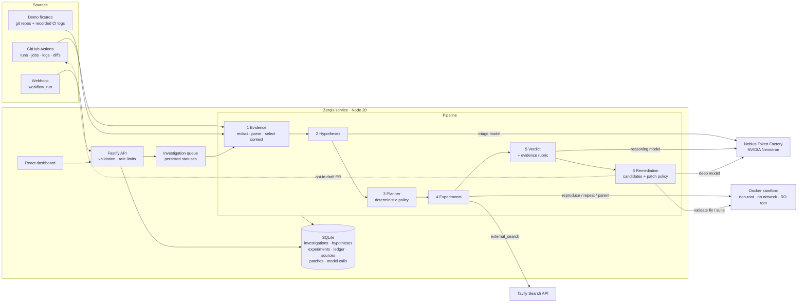

# Zerqis architecture

Zerqis is a single Node.js service (Fastify API plus a React dashboard served as static files) backed by SQLite. It drives three external systems: **Nebius Token Factory** (Nemotron inference), **Tavily** (web search), and **GitHub** (runs, logs, diffs, webhooks, draft PRs). It also drives a local **Docker** daemon that executes experiments in throwaway containers.



## Components

| Module | Responsibility |
|---|---|
| `analysis/redact.ts` | Removes tokens (GitHub, npm, Tavily, AWS, Slack, JWT, `sk-`), private keys, URL credentials, and `*_TOKEN/KEY/SECRET/PASSWORD=` values before anything is stored or sent |
| `analysis/logs.ts` | Jest, Maven, pytest, Go, `tsc`, and Mocha failure extraction, failure signature, long-log context selection, quote verification |
| `analysis/diff.ts` | Changed files, docs-only detection, npm, Maven, and PyPI (requirements files) dependency version changes with exact lines |
| `llm/client.ts` | OpenAI-compatible Token Factory client: timeouts, retries, structured-output degradation, Zod validation and repair; disables Nemotron reasoning (`enable_thinking: false`) so output stays JSON |
| `llm/models.ts` | Resolves a Nemotron model per role from the live `/v1/models` catalog |
| `runner/docker.ts` | Hardened `docker run` for untrusted workloads; output caps; kill on timeout |
| `runner/workspace.ts` | Clean checkout at a SHA (hooks disabled; fork-PR SHAs fetched), dependency install, patch policy, `git apply` |
| `runner/frameworks.ts` | Fixed command templates for Jest, Maven, pytest, Go, and `tsc` checks, selection validation, result parsing (Jest JSON, Surefire XML) |
| `runner/typescript.ts` | TypeScript policy for Jest projects: supported-layout check with explicit reasons (single package, ts-jest or Babel), `tsc` diagnostics parsing |
| `runner/golang.ts` | Go policy: supported-layout check (single root module, no go.work/vendor/local replaces), `go test -json` parsing, package and test-name validation, test-file lookup for quarantine |
| `runner/python.ts` | pytest policy: supported-layout check with explicit reasons, requirements-line allowlist (PyPI names, versions, markers only), JUnit XML parsing into node IDs |
| `pipeline/change.ts` | Change verification rules: revision resolution, test-scope checks (shrunk scope, edited or skipped tests), outcome and fix-outcome decisions, the not-examined list |
| `pipeline/investigate.ts` | Orchestrates the six stages, writes the Evidence Ledger, manages live, replay, and heuristic modes |
| `pipeline/effects.ts` | Deterministic rules mapping experiment outcomes to *supports / contradicts* per hypothesis category |
| `pipeline/confidence.ts` | Evidence rubric and verdict capping |
| `pipeline/remediation.ts` | Quarantine, dependency pin, and revert candidates; materializes model edits into reviewable diffs |
| `integrations/github.ts` | REST client, run URL parsing, HMAC webhook verification, log download via signed redirect, Git Data API draft PRs |
| `integrations/tavily.ts` | Search client, retries, primary-source classification |

## Data model

SQLite (WAL mode) with ordered migrations (`PRAGMA user_version`). Entity tables keep queryable columns (status, classification, verdict, repository, dedupe key) alongside a typed JSON document.

- `investigations`: metadata (repository, SHA, parent, branch, workflow, job, run, PR), status, stage, mode, signature, classification, verdict, confidence plus basis, verdict history, limitations, models used, options. `dedupe_key` (`gh:<repo>:<run>:<attempt>`) is unique, which makes webhook and manual intake idempotent.
- `hypotheses`, `experiments` (attempts with exit code, seed, test counts, output tail; environment; observation; effect), `evidence` (ordered ledger with kind and provenance), `sources`, `patches` (diff, validation, PR URL), `model_calls` (model, latency, tokens, status, error).
- `ci_logs` (redacted text), `webhook_deliveries` (unique delivery ID), `repositories`, `settings` (non-secret only).

Secrets live only in environment variables and are never written to the database.

## Investigation lifecycle

`queued → running (stage text updates) → completed | inconclusive | failed`. An in-process queue runs one investigation at a time (configurable) because each one starts containers. On startup, investigations left `queued` or `running` are marked `failed` with an explanation and can be re-run. The UI polls every 1.5 s while an investigation is active, and every attempt is persisted as it finishes, so progress is visible run by run.

## Modes

| Mode | Model stages | Experiments |
|---|---|---|
| `live` | Nemotron via Token Factory; failures fall back per stage to heuristics with a recorded limitation | Real |
| `replay` | Outputs recorded from an earlier **live** run of the same demo scenario (`data/replays/` or `fixtures/scenarios/<id>/replay.json`), validated against the same schemas; labeled "Replay" | Real |
| `heuristic` | Deterministic rules; labeled "Heuristic" | Real |

Live mode was verified on 2026-10-16 with the three models above; see `docs/verification/live-cloud-verification.md`. The investigation is single-pass: the model is not asked to choose follow-up experiments.

`auto` picks live when `NEBIUS_API_KEY` is set, replay when a recording exists, and heuristic otherwise. Live runs of demo scenarios record their validated model outputs automatically.

## Security model

**Threats:** malicious repository code, build scripts, or test fixtures; prompt injection in logs; model output that tries to run commands or exfiltrate data; webhook forgery; and leaked secrets.

**Controls**
- **No model-supplied commands.** Models choose from a fixed experiment menu. Commands come from templates; test selections are validated (path and identifier regexes) and passed as argv; Jest name patterns are regex-escaped.
- **Container isolation.** uid 1000, `--cap-drop ALL`, `no-new-privileges`, `--read-only` with tmpfs `/tmp`, `--pids-limit 512`, memory and swap and CPU limits, `--network none` for every test run, a timeout with `docker kill`, and capped output. Only the workspace and a per-repository dependency cache are mounted. The host environment, credentials, and Docker socket are never passed in.
- **Install phase.** `npm ci --ignore-scripts`; Maven `dependency:go-offline` plus explicit Surefire provider and JUnit launcher resolution, so no test code runs while the network is enabled.
- **Host-side git.** Hooks, fsmonitor, and LFS filters are disabled; no credential prompts; only `https://github.com/<owner>/<repo>` or local paths may be cloned; SHAs are validated.
- **Patch policy.** Patches may not touch `.git/`, `.github/`, `.npmrc`, `.mvn/`, or `.env*`. They may not traverse paths, change modes, add binaries, symlinks, or renames, or exceed 64 KiB. Model edits may only touch the non-test files the model was shown. Because candidates are applied before the network-enabled install step, patches may not add Maven build plugins, extensions, or repositories, or point npm dependencies or lockfile entries at non-registry sources.
- **Webhooks.** HMAC-SHA256 checked with `timingSafeEqual` against the raw body; unknown events ignored; delivery IDs deduplicated.
- **Model output.** Schema-validated, length-bounded, and treated as claims: cited quotes are verified, and verdicts are capped by the evidence rubric.
- **Public demo mode.** Per-IP rate limits, queue cap, no deletes, no settings changes, no PRs, no provider connection tests, and GitHub intake only for allow-listed repositories.
- **Client identity.** `X-Forwarded-For` is honoured only from proxies listed in `ALIBI_TRUST_PROXY` (default: none), so clients cannot spoof their address to evade per-IP limits. `deploy/setup-vm.sh` sets it to `127.0.0.1` for the bundled Caddy proxy.

**Known limitations**
- Docker containers share the host kernel; they are not a VM boundary. For untrusted repositories at scale, use gVisor/Kata, rootless Docker, or a remote sandbox such as Nebius Token Factory Sandboxes.
- The install phase has network access, and Maven plugins declared by the repository execute during `dependency:go-offline`. Use a pull-through registry mirror and egress allow-list in production.
- The Zerqis service itself needs access to the Docker daemon, so run it under a dedicated user on a dedicated VM.
- The sandbox image differs from the CI runner image, and Zerqis records this as an explicit *assumption* in every ledger.

## Deployment

The recommended host is a small **Nebius AI Cloud** Compute VM (Ubuntu 24.04, 4 vCPU / 8 GB is comfortable). Any Linux VM with Docker works. Serverless platforms cannot run the Docker sandbox.

```bash
sudo DOMAIN=alibi.example.com REPO=https://github.com/<you>/alibi bash deploy/setup-vm.sh
sudo -u alibi nano /opt/alibi/.env    # NEBIUS_API_KEY, TAVILY_API_KEY, ALIBI_DEMO_READONLY=true, HOST=127.0.0.1
sudo systemctl restart alibi
curl -fsS https://alibi.example.com/api/health
```

The script installs Docker, Node 20, and Caddy (automatic HTTPS). It creates an unprivileged `alibi` user in the `docker` group, builds the app, pre-pulls runner images, and installs `deploy/alibi.service`. Point a DNS A record at the VM before running it with `DOMAIN`. For the judging window, keep `ALIBI_DEMO_READONLY=true` and pre-run each scenario once in live mode so replays exist even if quota runs out.

## Extending

- **New framework:** add detection, install commands, a test command template, and a result parser in `runner/frameworks.ts`, plus log extraction in `analysis/logs.ts`.
- **Remote sandbox backend:** implement the `runContainer` contract (argv, workspace, network flag, timeout → exit code, output, duration) against Token Factory Sandboxes (`POST /sandboxes/v1/instances`, poll `GET /v1/operations/{id}`) once the account has Sandboxes access.
